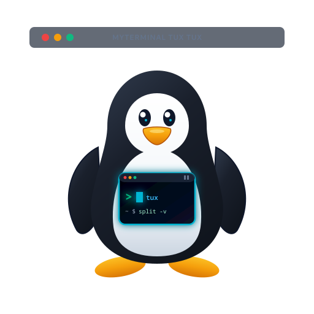

# <p align="center"><br>MyTerminal Tux Tux</p>

<p align="center">
  <b>Emulador de terminal multiplataforma (Linux, Windows y macOS) con divisiones estilo Terminator, grupos de comandos configurables, integración con Git, perfiles SSH con LED de estado, favoritos y persistencia de sesiones.</b>
</p>

<p align="center">
  
  
  
</p>

---

## ✨ Características Principales

### 1. Barra de Herramientas Inteligente por Terminal
Cada terminal abierta cuenta con una barra de herramientas completa:
- **Selector de Shells**:
  - **Linux / macOS**: Detecta automáticamente shells instaladas (`Bash`, `Zsh`, `Fish`, `Dash`, etc.).
  - **Windows**: Detecta `PowerShell`, `PowerShell 7`, `Command Prompt`, `Git Bash`, `WSL`, etc.
- **Carpetas Favoritas (`⭐▾`)**: Menú desplegable para saltar de inmediato a tus directorios guardados o agregar la carpeta actual con un clic.
- **Grupos de Comandos Configurables (`💻 Sistema ▾` / `🌿 Git ▾` / `🐳 Docker ▾`)**:
  - Conmutación automática inteligente: se activa el grupo Git si la carpeta es un repositorio, o el grupo predeterminado configurado (ej. Sistema) si no lo es.
  - Paleta interactiva de emojis/iconos al crear o editar grupos de botones.
  - Botones reordenables y personalizables con parámetros interactivos `{prompt:Mensaje}`.
- **Detección e Integración de Git**:
  - Pill de rama activa (`🌿 master ▾`): cambiar de rama o crear nuevas al vuelo.
  - Usuario Git (`👤 Usuario`): ver o editar autor del commit.
  - Botones rápidos: `Status`, `Add` (interactivo), `Commit` (con modal de mensaje), `Push`, `Pull`, `Fetch`, `Diff`, `Log`.
- **Sesión SSH Activa con Indicador LED Pulsante**:
  - Barra en rojo de alto contraste con LED verde parpadeante (`🟢`) tanto en la terminal como en la pestaña activa.
  - Botón de desconexión segura (`✖ Desconectar`).

---

### 2. División de Terminales (Splits estilo Terminator)
- Divide cualquier terminal **horizontalmente** (`Ctrl+Shift+O` o botón `⬍`) o **verticalmente** (`Ctrl+Shift+E` o botón `⬌`).
- Divisores interactivos arrastrables para ajustar proporciones.
- Árbol recursivo de divisiones ilimitadas en una sola pantalla.
- La nueva terminal hereda automáticamente el directorio de trabajo actual (`cwd`).

---

### 3. Pestañas (Tabs) y Sesiones
- Crea múltiples pestañas con `➕` o `Ctrl+Shift+T`.
- Renombrado rápido con doble clic.
- Indicador LED de sesión SSH en la pestaña correspondiente.
- **Guardado y Restauración de Sesiones**: Exporta/importa todas tus terminales, rutas y conexiones activas.

---

### 4. Menú Contextual (Click Derecho)
- ⬍ Dividir Horizontalmente (`Ctrl+Shift+O`)
- ⬌ Dividir Verticalmente (`Ctrl+Shift+E`)
- 🔑 Cargar Perfil SSH (con submenú)
- 📋 Copiar selección (`Ctrl+Shift+C`) / 📥 Pegar (`Ctrl+Shift+V` o botón rueda)
- 🧹 Limpiar pantalla
- ✕ Cerrar terminal (`Ctrl+Shift+W`) con confirmación si hay SSH activo

---

### 5. Copia de Seguridad y Portabilidad Multiplataforma
- En **Ajustes > Copia de Seguridad** puedes exportar toda la configuración de la aplicación en un único archivo JSON con nombre sugerido y fecha/hora (`myterminal-config-AAAA-MM-DD_HH-mm-ss.json`).
- Compatible entre computadoras Linux y Windows (con ajuste automático del shell por defecto de cada sistema).

---

### 6. Sincronización en la Nube con Google Drive (Zero-Knowledge)
- Sincroniza tus perfiles SSH, sesiones guardadas, pestañas y configuraciones entre computadoras de forma 100% privada.
- **Cifrado Zero-Knowledge (AES-256-GCM)**: Todos los datos confidenciales (usuarios, IPs, puertos y contraseñas de auto-login) se cifran localmente con una contraseña maestra antes de salir de tu equipo.
- Sin clientes de escritorio externos: la app se conecta directamente mediante la API oficial de Google Drive.

---

## ☁️ Guía de Sincronización en la Nube con Google Drive

MyTerminal Tux Tux permite sincronizar en la nube todos tus **perfiles SSH**, **sesiones**, **plantillas de pestañas** y **configuraciones de botones** de forma automática y cifrada.

```
┌────────────────────────────────────────────────────────┐
│                   MyTerminal Tux Tux                   │
│                                                        │
│  1. Empaquetar: Perfiles SSH + Sesiones + Ajustes      │
│  2. Cifrado local: AES-256-GCM con Contraseña Maestra   │
│  3. Envío seguro: Google Drive API (OAuth 2.0)         │
└──────────────────────────┬─────────────────────────────┘
                           │ HTTPS Directo
                           ▼
          ☁️ GOOGLE DRIVE [ tux-tux-sync.enc ]
               (Cifrado Zero-Knowledge)
```

### 🔐 Seguridad Zero-Knowledge
Los perfiles SSH suelen incluir usuarios, direcciones IP y contraseñas de auto-login. Por ello, la aplicación los cifra localmente en tu propia máquina mediante **AES-256-GCM** y derivación de claves **PBKDF2** (con 100,000 iteraciones y salt aleatorio) antes de subirlos a Google Drive. Ni Google ni intermediarios pueden leer tus credenciales.

---

### 📋 Pasos para Configurar la Sincronización

#### Paso 1: Obtener o reutilizar el archivo `credentials.json`
Si ya dispones de un archivo de credenciales de cliente OAuth (por ejemplo, el de proyectos como *MyGDriveSync*), puedes reutilizarlo directamente. 

Si deseas generar uno nuevo desde cero:
1. Accede a [Google Cloud Console](https://console.cloud.google.com/).
2. Crea un proyecto (ejemplo: *MyTerminal Tux Tux*) y activa la **Google Drive API** en la sección *APIs y servicios > Habilitar APIs*.
3. En **Pantalla de consentimiento de OAuth**:
   - Selecciona tipo de usuario *Externo* y completa el nombre y tu correo de soporte.
   - En *Permisos (Scopes)*, añade el permiso de Google Drive: `https://www.googleapis.com/auth/drive.file` o `drive.appdata`.
   - En *Usuarios de prueba*, añade tu propia dirección de Gmail.
4. En **Credenciales**:
   - Haz clic en *+ Crear credenciales > ID de cliente de OAuth*.
   - Tipo de aplicación: selecciona **App de escritorio (Desktop App)**.
   - Descarga el archivo JSON resultante (tendrá un nombre como `client_secret_xxx.json` o `credentials.json`).

#### Paso 2: Cargar las credenciales en la terminal
1. Abre MyTerminal Tux Tux y dirígete a **⚙️ Ajustes > ☁️ Google Drive**.
2. Haz clic en el botón **`📂 Cargar credentials.json...`**.
3. Selecciona tu archivo JSON. La aplicación registrará el cliente OAuth localmente.

#### Paso 3: Iniciar sesión con Google
1. En la misma pestaña, haz clic en **`🌐 Iniciar sesión con Google Drive`**.
2. Se abrirá automáticamente tu navegador web predeterminado pidiéndote autorizar la conexión con tu cuenta de Google.
3. Haz clic en **Permitir**.
4. Verás la pantalla de confirmación: *"¡Autenticación Exitosa!"*. Puedes cerrar el navegador y regresar a la terminal; verás tu correo conectado con un indicador verde (`usuario@gmail.com ● Conectado`).

#### Paso 4: Establecer la Contraseña Maestra de Cifrado
1. En la tarjeta **2. Contraseña Maestra de Cifrado**, introduce una contraseña segura.
2. ⚠️ **Importante:** Utiliza la misma contraseña maestra en todas tus computadoras para poder descifrar los datos que descargues de la nube.

#### Paso 5: Subir o Descargar tus Datos
- **Subir a la nube (`⬆️ Subir y Guardar en Drive`)**: Cifra todos tus perfiles SSH, sesiones y configuraciones, y crea/actualiza el archivo `tux-tux-sync.enc` en tu Google Drive.
- **Descargar de la nube (`⬇️ Descargar y Restaurar de Drive`)**: Descarga la última copia de tu Drive, la descifra con tu contraseña maestra y restaura de inmediato todos tus perfiles SSH y sesiones.
- **Comprobar Nube (`🔄 Comprobar Nube`)**: Muestra la fecha exacta y el tamaño de la copia almacenada en tu Google Drive.

#### ⚙️ Opciones de Sincronización Automática
Puedes marcar las siguientes casillas para que la app trabaje en segundo plano:
- `☑ Sincronizar automáticamente en la nube al salir de la aplicación`: Sube una copia actualizada al cerrar la terminal.
- `☑ Sincronizar automáticamente al guardar o editar perfiles SSH`: Realiza un respaldo inmediato cada vez que crees, modifiques o elimines un servidor SSH.

---

## ⌨️ Atajos de Teclado

| Atajo | Acción |
|---|---|
| `Ctrl + Shift + O` | Dividir terminal activa **horizontalmente** |
| `Ctrl + Shift + E` | Dividir terminal activa **verticalmente** |
| `Ctrl + Shift + T` | Abrir una **nueva pestaña** |
| `Ctrl + Shift + W` | **Cerrar** terminal activa (con confirmación si hay SSH) |
| `Ctrl + Shift + C` | **Copiar** selección al portapapeles |
| `Ctrl + Shift + V` / `Shift + Insert` | **Pegar** conservando el foco en la terminal |
| `Esc` | Cerrar cualquier ventana modal activa y devolver foco a la consola |
| `Click Central (Rueda)` | Pegar directamente en Linux |
| `Click Derecho` | Abrir menú contextual de la terminal |

---

## 📦 Compilación y Generación de Instaladores

### Ejecutar en Desarrollo
```bash
npm install
npm start
# O usando el script:
./run.sh
```

### Generar Paquetes e Instaladores
- **Para Linux**:
  ```bash
  npm run dist:linux            # Genera .AppImage (Portable) y paquete instalable .deb
  npm run dist:linux:portable   # Genera únicamente .AppImage
  ```
- **Para Windows**:
  ```bash
  npm run dist:win              # Genera instalador Setup NSIS (.exe) y versión Portable (.exe)
  npm run dist:win:portable     # Genera únicamente la versión Portable (.exe)
  ```
- **Para macOS**:
  ```bash
  npm run dist:mac              # Genera instalador .dmg y archivo .zip
  ```

Los archivos ejecutables finales se ubican en la carpeta `dist/`.

---

## 🤖 Compilación Automática en GitHub Actions (CI/CD)

El repositorio incluye un flujo de trabajo en `.github/workflows/build-and-release.yml`:
1. **En cada push a `main` o `master`**: Compila en paralelo para Linux (AppImage y deb), Windows (instalador y portable) y macOS (dmg), dejándolos como artefactos descargables.
2. **Al publicar una etiqueta de versión (`v*`, ej. `v1.0.0`)**: Publica automáticamente una **GitHub Release** con todos los instaladores y ejecutables portables listos para el público general.

---

## 🐧 Licencia
MIT License - El software y código se proporciona 'tal cual' (as is) sin garantías de ningún tipo.- Desarrollado con IA para uso personal.
